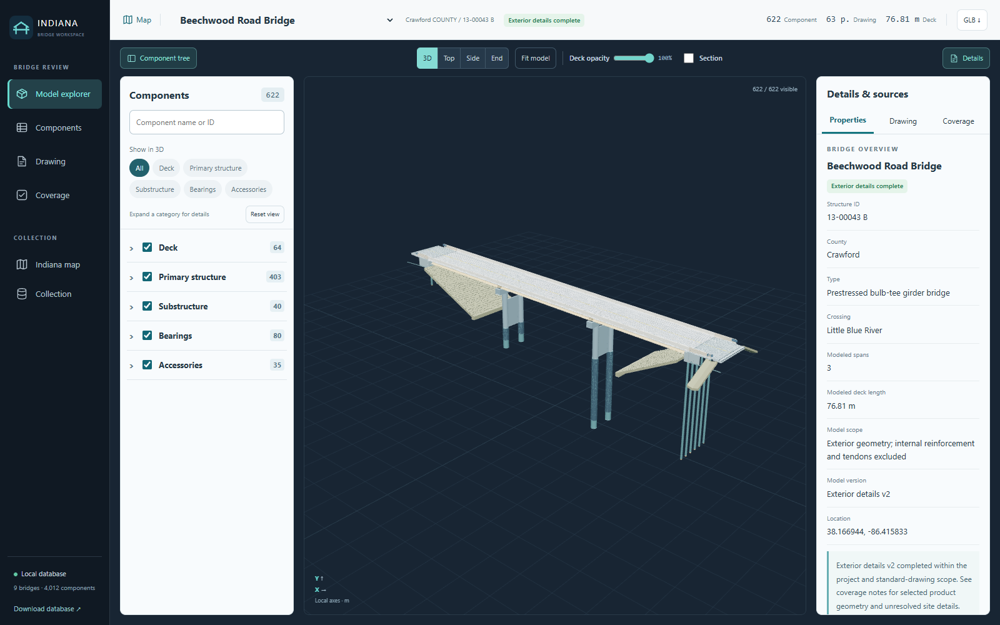

# Indiana Bridge 3D

A local bridge review workspace combining 3D models, a component database, source drawings and an Indiana road map. The interface, component descriptions and modeling notes are in English.



## Included collection

- **9 bridge models**, **4,012 components** and **106 original source groups**.
- **9 plan sets / 324 PDF pages**, with **5,666 component-to-page links**.
- **5,852 dimensional attributes** and **76 detail-coverage entries**.
- Bundled GLB models, PDF drawings, English model manifests and map boundaries.

The collection includes Beechwood Road, 21st Street over I-465, US 421 over South Fork Wildcat Creek, US 52 over Mud Creek, SR 58 over White Creek, SR 159 over Branch Spencer Creek, and three SR 62 crossings: CSX Railroad, Tekoppel Avenue and Carpentier Creek.

The **3D workspace shows four bridges**, with completed exterior models first. A fresh visit opens **Beechwood Road Bridge**, currently the only model with complete exterior coverage. The five SR-series records are **map only**: their locations and basic attributes remain visible, and all existing models, drawings and component records remain stored. They are excluded from the bridge selector and 3D entry points. Old SR model links open the corresponding map location.

Ownership and maintenance information is shown only where present in the sources. The SR 62 railroad/NBI association is provisional. See [source provenance](data/sources.json) and the in-app coverage notes.

## Run locally

Requires Python 3.9 or newer. Node.js and API keys are **not** required to run the bundled app.

```sh
git clone https://github.com/youngbrain85/indiana-bridge-3d.git
cd indiana-bridge-3d
python -m venv .venv
```

Activate the environment:

```powershell
# Windows PowerShell
.\.venv\Scripts\Activate.ps1
```

```sh
# macOS / Linux
source .venv/bin/activate
```

Then install the Python dependency and start the server:

```sh
python -m pip install -r requirements.txt
python server.py
```

Open **http://127.0.0.1:8766/**. On first launch, the server builds the SQLite database from the bundled registry and validates all model-to-component and drawing-page relationships. Keep the server running while using the app.

On Windows, after installing dependencies, `Start Bridge Manager.cmd` can launch the app in the background. It prefers the repository's `.venv`. An alternate port is available with `python server.py --port 8767`.

The application binds to localhost. It is a local viewer, not an authenticated multi-user hosting service. Public GitHub source availability does not deploy a hosted web app.

## Workspace

- **Model explorer:** one compact header, fixed equal-width side panels, camera presets, deck opacity and longitudinal section controls.
- **Component tree:** initially collapsed Deck, Primary structure, Substructure, Bearings and Accessories categories. Expand them to reach source groups, specified locations and individual components.
- **3D filters:** category buttons affect both actual mesh visibility and the tree. Group isolation includes every descendant, including members outside a search result.
- **Details & sources:** component dimensions, modeling basis, assumptions, drawing links and coverage. Selection actions are located here.
- **Components:** searchable, paginated register with CSV export and direct links back to 3D.
- **Indiana map:** county boundaries, road layer, bridge markers and model-detail status. Green means exterior detail coverage is complete within the stated scope; amber means additional detail is needed. These are **not structural condition ratings**.
- **Drawings:** locally rendered PDF pages and original plan downloads.
- **Exports:** GLB model, component CSV and the current SQLite database.
- **UI review:** visit `/review` to annotate a reference screenshot, add numbered notes and export PNG or JSON. Notes are stored only in the browser.

The models and drawings work offline. The USGS road layer requires internet access and reports its connection status independently.

## Data and limitations

The app presents existing models; it does not generate geometry or invent inspections, defects, sensor readings or maintenance records. Some source sets are preliminary designs or general-arrangement extracts. Fabrication details, final site values and internal reinforcement may be unavailable or outside scope.

The English release translates metadata while preserving numeric values, stable component IDs, geometric assets and source plan bytes. Each model keeps its original assumptions, approximations and missing-detail notes. Individual component volumes can overlap and are not quantity takeoffs.

Original PDF and GLB hashes are recorded in [data/sources.json](data/sources.json). Source links are inherited from the collection and were not revalidated for this release. Third-party plan documents retain their original notices and attribution.

## Repository layout

```text
server.py                 Local HTTP service and read-only API
import_data.py            Validated, repeatable SQLite importer
schema.sql                Database schema
data/registry.json        Portable bridge registry
data/bridges/<id>/         Model, manifest, plan PDF and preview
data/sources.json          Plan URLs and asset hashes
web/                      English frontend and bundled viewer
viewer.js                 Three.js viewer source
docs/                     Architecture and verification notes
```

Runtime files are generated locally and excluded from Git: `data/bridges.sqlite3`, `data/assets/`, PDF preview caches, logs, process IDs and test screenshots. The database can be rebuilt with `python import_data.py` or downloaded from the app. Back up the repository and any locally added source assets together.

## Add or update a bridge

1. Add `model.glb`, `model_manifest.json`, `drawings.pdf` and optionally `preview.png` under `data/bridges/<new-id>/`.
2. Use a unique lowercase registry ID. GLB mesh names and manifest part IDs must match one-to-one. Each component must have a valid source layer and any PDF page references must be one-based and within the plan set.
3. Add an entry in `data/registry.json`, following an existing record. Model and thumbnail paths are relative to the registry directory; `source_pdf` is relative to the manifest. Supply actual location provenance and a justified detail status.
4. Preserve modeling assumptions, limitations and source citations in the manifest. Update `source_sha256` when the source PDF changes.
5. Run `python import_data.py`, then refresh the app. Import validates all sources before changing the current catalog. Repeated imports do not duplicate components.

An optional ignored `source_overrides.json` can point to private local source PDFs. Do not commit it. Existing bridges omitted from a partial import are retained; deletion is not automated.

Set a bridge's `workspace_enabled` field to `false` for map-only presentation, or `true` to include it in the 3D workspace (the default for new records). The flag is a presentation choice, independent of span count, ownership or model-detail status. Restarting the server synchronizes these settings into SQLite and upgrades older databases without deleting records; importing also applies the settings. Eligible bridges are sorted by complete exterior coverage first, retaining registry/import order within each status.

## Development and tests

Node.js is needed only to rebuild the bundled viewer or run browser tests:

```sh
npm ci
npm run build
python test_manager.py
npx playwright install chromium
```

With `python server.py` running in another terminal:

```sh
npm run test:browser
```

Set `BRIDGE_TEST_URL` to test another port. Set `BROWSER_EXECUTABLE` to use an installed Chromium/Edge binary instead of Playwright's browser.

Backend checks cover repeat imports, integrity, stable IDs, all nine bridge APIs, presentation migration, complete-first ordering, source pages, exports, byte ranges and path restrictions. Browser checks load the four workspace models, verify map-only routing for all five SR records, and exercise isolation, search, selection, drawings, opacity, sectioning, mobile layouts and rapid navigation. See [verification notes](docs/verification.md).

## Dependencies and attribution

Three.js 0.180.0, Leaflet 1.9.4, PyMuPDF, SQLite, US Census boundary data and the USGS National Map road service. See [third-party notices](THIRD_PARTY_NOTICES.md).
